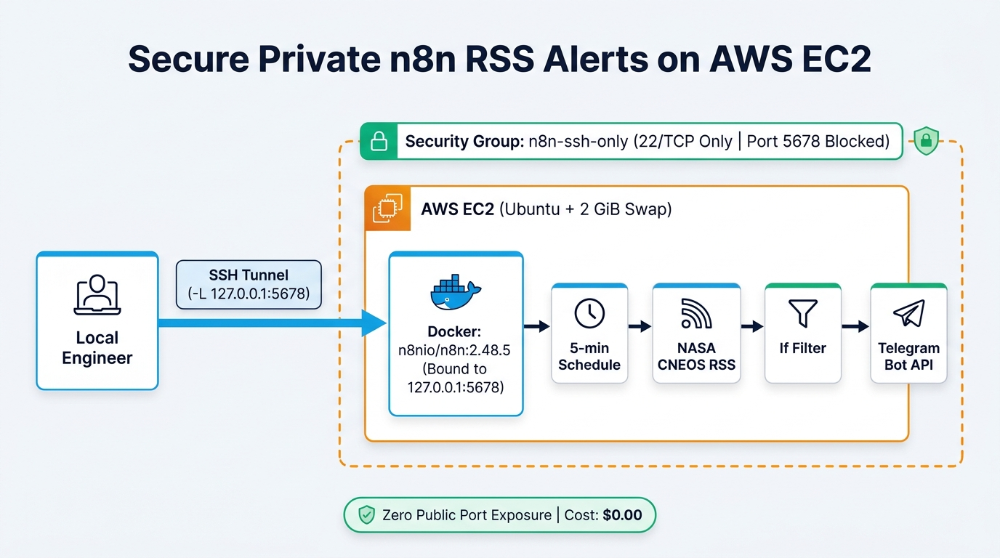
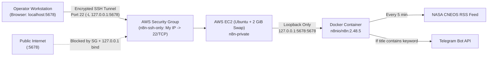

<div align="center">



# Secure Private n8n RSS Alerts on AWS EC2


**Self-hosted n8n automation on AWS EC2 with zero public web exposure, accessible exclusively over an encrypted SSH local port-forwarding tunnel, delivering keyword-filtered NASA CNEOS RSS alerts to Telegram.**

</div>

---

## 1. Architecture Overview



> [!IMPORTANT]
> **Key Design Decision:** Instead of exposing the n8n admin UI on port `5678` or managing a reverse proxy with public TLS certificates, the container binds strictly to `127.0.0.1:5678` and the Security Group allows only SSH (`22/TCP`) from the operator's IP. All UI access happens over an on-demand SSH tunnel (`ssh -N -L`).

---

## 2. Problem & Solution
| Aspect | Detail |
| :--- | :--- |
| **Problem** | Self-hosting workflow tools like n8n on a public cloud VM often exposes the login/editor port (`5678`) to internet scanners and brute-force attacks, while low-RAM instances risk OOM crashes during container operations. |
| **Solution** | Deployed n8n via Docker Compose on Ubuntu EC2 with a persistent 2 GiB swap file, bound the service to `127.0.0.1`, accessed the UI exclusively through an SSH tunnel, and automated keyword-filtered RSS-to-Telegram alerts. |
| **Security Boundary** | Two independent controls block public access: (1) AWS Security Group `n8n-ssh-only` only allows port `22` from the operator's IP, and (2) Docker binds `127.0.0.1:5678:5678` so n8n never listens on the public interface. |

---

## 3. Tech Stack
- **Cloud:** AWS EC2 (`us-west-2`), EBS (`gp3`), AWS Security Groups, Key Pairs (`.pem`)
- **Networking / Security:** SSH Local Port Forwarding (`ssh -N -L`), Loopback Binding (`127.0.0.1`), Principle of Least Privilege
- **Containers / Automation:** Docker Engine, Docker Compose (`compose.yaml`), n8n (`n8nio/n8n:2.48.5`), Linux Swap (`2 GiB`), Telegram Bot API, NASA CNEOS RSS Feed

---

## 4. Implementation Steps (Summary)
1. **Provision & Harden EC2 Host:** Launched `n8n-private` on Ubuntu in `us-west-2` with Security Group `n8n-ssh-only` permitting SSH (`22/TCP`) from the operator's IP only.
2. **Install Docker & Configure Swap:** Installed Docker Engine & Docker Compose plugin, then created and persisted a `2 GiB` `/swapfile` in `/etc/fstab` for memory stability.
3. **Deploy Private n8n:** Configured [`compose.yaml`](./compose.yaml) with `127.0.0.1:5678:5678` binding and persistent `n8n_data` volume; verified `/healthz` locally and confirmed `http://<PUBLIC_IP>:5678` fails externally.
4. **Access via SSH Tunnel:** Opened an encrypted local port-forward tunnel (`ssh -N -L 127.0.0.1:5678:127.0.0.1:5678`), completed owner setup at `http://localhost:5678`, and verified closing the tunnel immediately revokes access.
5. **Build & Filter RSS-to-Telegram Workflow:** Connected `RSS Feed Trigger` (`https://cneos.jpl.nasa.gov/feed/news.xml`, 5-minute poll) -> `If` node (`title contains <keyword>`) -> `Telegram` (`Send Message`), verified both `true` and `false` branches, and published the workflow.

<details>
<summary><b>Click to expand verification commands & config snippets</b></summary>

```bash
# 1. Verify Docker & persistent 2 GiB swap on EC2
docker --version
docker compose version
swapon --show

# 2. Start private n8n & check local health endpoint
docker compose up -d
docker compose ps
curl -sf http://localhost:5678/healthz
```

```powershell
# 3. Open encrypted SSH tunnel from workstation
ssh -N -L 127.0.0.1:5678:127.0.0.1:5678 -i "<PATH_TO_KEY>.pem" ubuntu@<PUBLIC_IPV4_DNS>
```

</details>

---

## 5. Verification & Results
- **Full Project Documentation:** [NextWork Project Documentation](https://nextwork.ai/hemaa/docs/3191c4e6-7776-4b75-9db2-40266083fc20)
- **Local Health Check:** `curl -sf http://localhost:5678/healthz` returned `{"status":"ok"}` with container port bound strictly to `127.0.0.1:5678->5678/tcp`.
- **Public Boundary Test:** Direct browser requests to `http://<PUBLIC_IPV4>:5678` timed out/refused; closing the SSH tunnel with `Ctrl+C` immediately broke `http://localhost:5678` access until reopened.
- **Workflow & Filter Proof:** Matching RSS headlines routed through the `If` node's `true` output to deliver Telegram alerts, while non-matching headlines exited quietly through the unconnected `false` branch.

---

## 6. Key Engineering Takeaways
- **Defense in Depth for Admin UIs:** Combining host-level loopback binding (`127.0.0.1`) with network-level Security Group rules and SSH tunneling keeps internal tools completely invisible to the public internet.
- **Cost & Stability on Small Instances:** Adding a 2 GiB swap file prevents memory spikes on Free Tier instances, and keeping infrastructure codified in `compose.yaml` + exported workflow JSON allows terminating the EC2 instance (`$0` ongoing cost) and redeploying in minutes.
